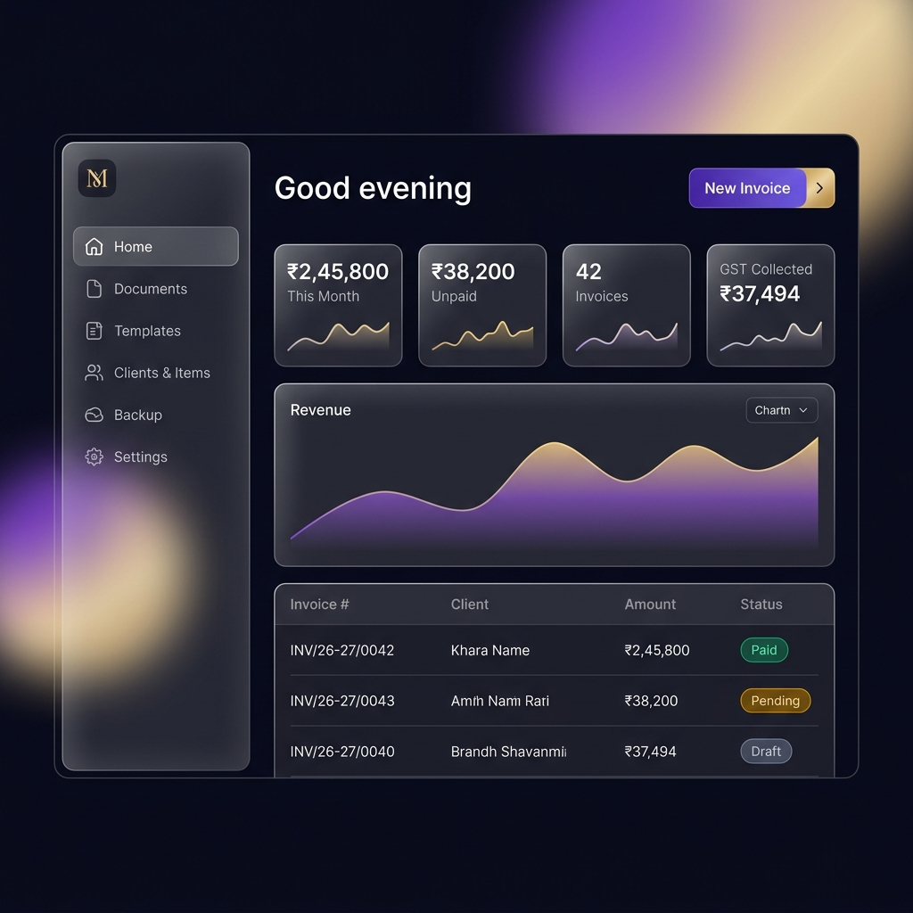

# INGEN

**Design document templates. Generate beautiful GST invoices. Offline, private, on your device.**

---

INGEN is a local-first **Progressive Web App** for Indian small businesses. You can:

- **Design** invoice, quotation, receipt or prescription templates with a drag-and-drop builder, on desktop and on mobile.
- **Fill** forms that are generated automatically from your template, with client and item autocomplete.
- **Calculate** GST correctly (CGST/SGST/IGST, HSN summary, round-off) using precise decimal math.
- **Generate** vector PDFs in the browser and share them straight to WhatsApp or Email.
- **Protect** your data with an optional password or fingerprint Vault and encrypted backups.

There is **no server**: your data never leaves your device.

## Documentation

| Document | Description |
|---|---|
| [Architecture](docs/ARCHITECTURE.md) | System design, layers, data flows, trap register |
| [Data Model](docs/DATA_MODEL.md) | Entities, Template Definition schema, Dexie tables |
| [Design System](docs/DESIGN_SYSTEM.md) | Tokens, themes, glass rules, components |
| [Decisions](docs/DECISIONS.md) | Architecture Decision Records |
| [Roadmap](docs/ROADMAP.md) | Phases, tasks, exit criteria |
| [Conventions](docs/CONVENTIONS.md) | Code, testing and Git rules |

### Feature specs
| # | Feature |
|---|---|
| 00 | [App Shell & Navigation](docs/features/00-app-shell-navigation.md) |
| 01 | [Onboarding & Companies](docs/features/01-onboarding-companies.md) |
| 02 | [Template Builder](docs/features/02-template-builder.md) |
| 03 | [Field Registry & Custom Fields](docs/features/03-field-registry-custom-fields.md) |
| 04 | [Formula & GST Engine](docs/features/04-formula-gst-engine.md) |
| 05 | [Document Generator](docs/features/05-document-generator.md) |
| 06 | [Catalog & Autocomplete](docs/features/06-catalog-autocomplete.md) |
| 07 | [Sequence Numbering](docs/features/07-sequence-numbering.md) |
| 08 | [PDF Compiler](docs/features/08-pdf-compiler.md) |
| 09 | [Share & Export](docs/features/09-share-export.md) |
| 10 | [UPI QR](docs/features/10-upi-qr.md) |
| 11 | [Formatters & Amount-in-Words](docs/features/11-formatters-amount-in-words.md) |
| 12 | [Security Vault](docs/features/12-security-vault.md) |
| 13 | [Backup & Restore](docs/features/13-backup-restore.md) |
| 14 | [Dashboard & Documents](docs/features/14-dashboard-documents.md) |
| 15 | [PWA & Offline](docs/features/15-pwa-offline.md) |

## Tech Stack
React 19 · TypeScript · Vite · shadcn/ui · Tailwind CSS v4 · Zustand · Dexie.js · react-hook-form + zod · big.js · @react-pdf/renderer (Web Worker) · pdf.js · @dnd-kit · fflate · Web Crypto · WebAuthn · vite-plugin-pwa

## Status
📐 **Specification phase.** The docs are being reviewed before implementation starts (see [Roadmap](docs/ROADMAP.md)).
