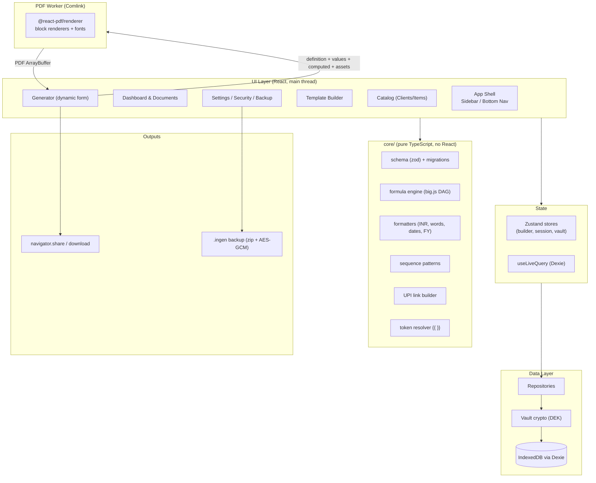
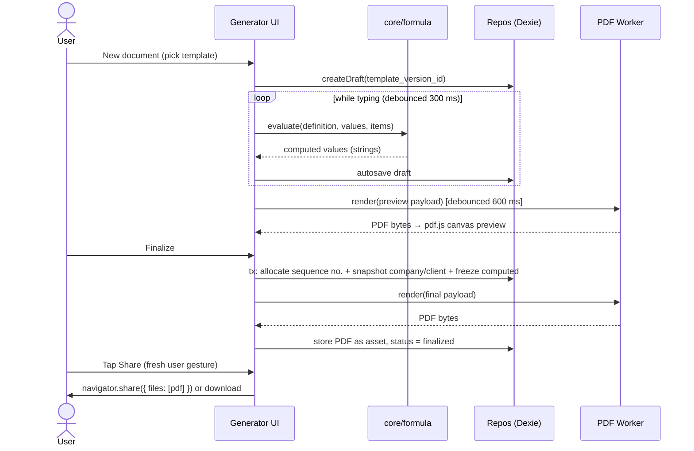
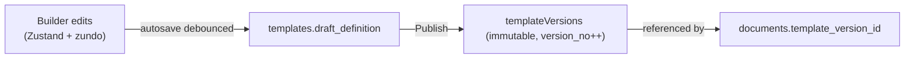
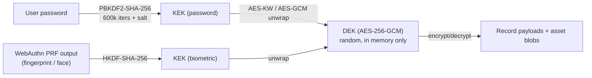

# INGEN — Architecture

> **INGEN** is a local-first, offline-capable Progressive Web App for designing document templates and generating vector PDFs (invoices, quotations, receipts, estimates, prescriptions). It is built for Indian small businesses. There is no backend: all data stays on the device.

| Doc | Purpose |
|---|---|
| [DATA_MODEL.md](./DATA_MODEL.md) | Every entity, the Template Definition schema, Dexie tables, migrations |
| [DESIGN_SYSTEM.md](./DESIGN_SYSTEM.md) | Tokens, themes, glass rules, components, navigation |
| [DECISIONS.md](./DECISIONS.md) | Architecture Decision Records (the "why") |
| [ROADMAP.md](./ROADMAP.md) | Build phases, tasks, exit criteria |
| [CONVENTIONS.md](./CONVENTIONS.md) | Code style, folder rules, testing, naming |
| [features/](./features) | One spec per feature: behaviour + technical implementation |

---

## 1. Principles

1. **Local-first, zero backend.** IndexedDB is the only database. The app is fully usable offline after the first load.
2. **Single source of truth per concern.**
   - One zod schema produces the TS types, runtime validation, and import validation.
   - One template JSON model is used on every device.
   - One formula engine computes every number.
3. **History never changes.** A finalized document is frozen: its template version, company and client snapshots, computed values, and PDF are all kept as they were.
4. **Money is never a JS `number`.** All amounts are decimal strings and are computed with `big.js`.
5. **Coordinates are PDF points.** Screen pixels are never stored.
6. **The worker is a dumb renderer.** All calculation happens in `core/`. The PDF worker only turns *already computed* data into a PDF.
7. **Privacy by design.** The optional Secure Vault encrypts data at rest. Backups can be password-encrypted. Nothing is sent over the network.
8. **Built for budget devices.** Heavy libraries are lazy-loaded, glass effects are used sparingly, and long lists are virtualized.

---

## 2. Tech Stack

| Area | Choice | Notes |
|---|---|---|
| Build | **Vite** + **React 19** + **TypeScript (strict)** | Native Web Worker support (`?worker`) |
| UI kit | **shadcn/ui** (Radix primitives) + **Tailwind CSS v4** | Components live in the repo and are restyled with INGEN tokens |
| Icons / motion / toasts | `lucide-react`, `motion`, `sonner` | |
| Routing | React Router (data router, lazy routes) | |
| Editor state | **Zustand** + Immer + **zundo** (undo/redo) | Only for ephemeral editor/session state |
| Persistence | **Dexie.js** + `dexie-react-hooks` | Accessed only through repositories in `src/db/repos` |
| Forms | **react-hook-form** + **zod** | Forms are generated from the template's Field Registry |
| Math | **big.js** + an in-house formula parser | DAG evaluation, cycle detection |
| PDF | **@react-pdf/renderer** in a Web Worker via **Comlink** | Preview rendered with **pdf.js** onto canvas |
| Drag & drop | **@dnd-kit** + custom pointer resize handles | |
| QR | `qrcode` → SVG path → react-pdf `<Svg>` | Vector QR |
| Zip | **fflate** | Streaming zip |
| Crypto | **Web Crypto API** (AES-256-GCM, PBKDF2-SHA-256, HKDF) | No third-party crypto |
| Biometrics | **WebAuthn** platform authenticator + **PRF extension** | Quick unlock for the Vault |
| PWA | **vite-plugin-pwa** (Workbox) | Prompt-to-update |
| IDs | `ulid` with type prefixes | e.g. `doc_01JB…` |
| Testing | **Vitest**, **Playwright**, Testing Library | |

---

## 3. High-Level Architecture



### 3.1 Layer rules
- `core/` imports nothing from React, Dexie, or the DOM. The UI and the worker both import it.
- UI code never calls `db.table` directly. It always goes through a **repository** (`src/db/repos/*`). Repositories handle Vault encryption/decryption, snapshotting, and transactions.
- The **PDF worker** imports `core/` (formatters, token resolver) and `pdf/blocks/*`. It never touches Dexie.
- Zustand never mirrors database tables. Persistent data is read with `useLiveQuery`, so the UI updates when the DB changes.

---

## 4. Modules

| Module | Folder | Feature spec |
|---|---|---|
| App Shell & Navigation | `src/design-system`, `src/app` | [00-app-shell-navigation](./features/00-app-shell-navigation.md) |
| Onboarding & Companies | `src/features/onboarding`, `src/features/companies` | [01-onboarding-companies](./features/01-onboarding-companies.md) |
| Template Builder | `src/features/builder` | [02-template-builder](./features/02-template-builder.md) |
| Field Registry & Custom Fields | `src/core/schema`, `src/features/builder/fields` | [03-field-registry-custom-fields](./features/03-field-registry-custom-fields.md) |
| Formula & GST Engine | `src/core/formula` | [04-formula-gst-engine](./features/04-formula-gst-engine.md) |
| Document Generator | `src/features/generator` | [05-document-generator](./features/05-document-generator.md) |
| Catalog & Autocomplete | `src/features/catalog` | [06-catalog-autocomplete](./features/06-catalog-autocomplete.md) |
| Sequence Numbering | `src/core/sequence`, `src/db/repos/sequences` | [07-sequence-numbering](./features/07-sequence-numbering.md) |
| PDF Compiler | `src/pdf` | [08-pdf-compiler](./features/08-pdf-compiler.md) |
| Share & Export | `src/features/share` | [09-share-export](./features/09-share-export.md) |
| UPI QR | `src/core/upi`, `src/pdf/blocks/UpiQr` | [10-upi-qr](./features/10-upi-qr.md) |
| Formatters & Amount-in-Words | `src/core/format` | [11-formatters-amount-in-words](./features/11-formatters-amount-in-words.md) |
| Security Vault | `src/security` | [12-security-vault](./features/12-security-vault.md) |
| Backup & Restore | `src/backup` | [13-backup-restore](./features/13-backup-restore.md) |
| Dashboard & Documents | `src/features/dashboard`, `src/features/documents` | [14-dashboard-documents](./features/14-dashboard-documents.md) |
| PWA & Offline | `vite.config.ts`, `src/pwa` | [15-pwa-offline](./features/15-pwa-offline.md) |

---

## 5. Core Data Flows

### 5.1 Create → Finalize → Share



**Key rules**
- The sequence number is allocated **only at finalize**, inside a Dexie `rw` transaction on `sequences` + `documents`. Drafts have no number, so there are no gaps.
- `navigator.share()` is called in a **separate tap**, after the PDF is ready. This keeps the user gesture valid on iOS Safari.
- A finalized document is **read-only**. Corrections go through *Cancel* (the number is kept and marked cancelled) or *Duplicate as new draft*.

### 5.2 Template edit → version



- The builder always edits a **draft definition**. **Publish** creates a new immutable `TemplateVersion`.
- New documents use the template's `current_version_id`. Existing drafts keep their version until the user chooses "Update to latest".

### 5.3 Rendering pipeline (main thread → worker)

1. `core/formula.evaluate()` turns `{definition, values, items, context}` into `computed`.
2. `core/tokens.resolveAll()` resolves `{{tokens | pipes}}` in text blocks into plain strings, except page tokens. Page tokens (`{{page.number}}`, `{{page.total}}`) are resolved inside the worker through the react-pdf `render` prop.
3. Asset blobs are decrypted if the Vault is on, then converted to `ArrayBuffer`s and **transferred** to the worker.
4. The worker builds `<Document><Page>` from layout zones and body rows. It returns the PDF bytes as a transferable `ArrayBuffer`.

---

## 6. Layout Model

INGEN uses **one canonical layout model** on every device. The layout model depends on the **zone**, not the device.

```
┌──────────────────────────── page (pt) ────────────────────────────┐
│ margin                                                             │
│  ┌──────────────────────── HEADER (fixed, absolute) ────────────┐  │
│  └──────────────────────────────────────────────────────────────┘  │
│  ┌──LEFT──┐ ┌──────────── BODY (flow, 12-col rows) ──┐ ┌─RIGHT─┐  │
│  │ fixed  │ │ rows paginate across pages             │ │ fixed │  │
│  │ abs.   │ │                                        │ │ abs.  │  │
│  └────────┘ └────────────────────────────────────────┘ └───────┘  │
│  ┌──────────────────────── FOOTER (fixed, absolute) ────────────┐  │
│  └──────────────────────────────────────────────────────────────┘  │
└────────────────────────────────────────────────────────────────────┘
```

| Zone | Model | Repeats | PDF implementation |
|---|---|---|---|
| Header / Footer / Left / Right | Absolute frames `{x,y,w,h}` in pt, relative to the zone origin | Per Continuation Mode (`repeat_page_1` vs `custom_page_2`) | `<View fixed style={{position:'absolute', …}}>` |
| Body | Flow: `rows[] → cols[] (span 1–12) → blocks[]` | Paginates | Normal flow inside `<Page>` with derived padding |

- **Page padding is derived, never stored:** `top = margin + header.height`, `bottom = margin + footer.height`, `left = margin + left.width`, `right = margin + right.width`.
- **Multi-Page Continuation Architecture:**
  - **Repeat Page 1 (`continuation.mode = 'repeat_page_1'`):** Fixed Header and Footer repeat identically on all overflow pages.
  - **Custom Page 2+ (`continuation.mode = 'custom_page_2'`):** Page 1 contains full branding, tax headers, and business parameters. Page 2+ continuation header renders compact continuation info (e.g. Patient Vitals or Invoice Reference) and auto-replicates across Page 3+.
- **Scratch Page Architect:** 3-step wizard with 12×12 bi-directional blueprint painting (Fixed Blue parts vs Variable Teal parts).
- **Desktop builder:** free drag and resize in fixed zones, with live height sliders (28–340 pt).
- **Mobile builder:** the same frames, always snapped to an 8 pt grid, edited through tap-select, a bottom-sheet inspector, nudge arrows, and pinch zoom.
- Both edit the same JSON (see [02-template-builder](./features/02-template-builder.md)).

### 6.1 Virtual canvas & PDF Preview Modal
- The store holds PDF points (A4 = 595.28 × 841.89).
- The canvas renders at `scale = containerWidth / page.width` using CSS `transform: scale()`.
- dnd-kit deltas are converted to points with a modifier: `delta_pt = delta_px / scale`. Snapping is applied in point space.
- The builder renders text with the **same font files** as the PDF to keep WYSIWYG drift small.
- **Crash-Proof PDF Preview:** The live PDF is compiled asynchronously with a loading spinner. The preview opens in a high-fidelity `<Modal>` housing an `<object data={url} type="application/pdf">` viewer, with 1-click "Open in Full Tab" and "Download PDF" actions. This completely eliminates Chromium iframe extension message port crashes (`runtime.lastError: message port closed`).

### 6.2 Pagination rules (react-pdf)
- Table header row: `fixed` inside the table view, so it repeats on every page the table spans.
- Table rows: `wrap={false}`, so a row never splits across pages.
- Totals / summary blocks: `minPresenceAhead` to avoid orphaned totals; body rows can set `keep_together`.
- Page numbers: `<Text render={({pageNumber,totalPages}) => …} fixed />`. In dynamic `<View render>` continuation views, `isInsideViewRender: true` prevents invalid nested render prop recursion.


---

## 7. Calculation Model

- Templates declare **input fields** (`fields[]`) and **computed fields** (`computed[]`, with formula expressions).
- The engine parses each expression into an AST, builds a dependency graph, topologically sorts it (Kahn's algorithm), and reports cycles to the builder with the field names involved.
- Evaluation order:
  1. Line-item computed fields, per row.
  2. Document-level computed fields (which can aggregate rows with `sum(items.x)`).
  3. Built-in summaries (`tax_summary`, `hsn_summary`).
- Every operation uses `big.js`. Results are stored as **strings**. Rounding follows `config.rounding`.
- The **Modifier Stack** in the builder is a friendly UI that compiles to formulas. **GST presets** generate the standard Indian invoice formulas, including the CGST+SGST vs IGST split based on place of supply.
- Full spec: [04-formula-gst-engine](./features/04-formula-gst-engine.md).

---

## 8. Persistence Model

Full schema in [DATA_MODEL.md](./DATA_MODEL.md).

- **Tables:** `companies`, `clients`, `items`, `templates`, `templateVersions`, `documents`, `sequences`, `assets`, `settings`.
- **IDs:** prefixed ULIDs. They sort by time, don't collide when backups are merged, and keep a future sync possible.
- **Immutability:** `templateVersions` are write-once. Finalized `documents` are write-once, except `payment` and `cancelled` metadata. Assets are write-once.
- **Snapshots at finalize:** company, client, computed values, template_version_id, and the PDF asset.
- **Asset GC:** a background sweep deletes assets that nothing references (logos, signatures, PDFs, template images) and that are older than 24 h.
- **Storage durability:** call `navigator.storage.persist()` after install or the first finalize. Show `navigator.storage.estimate()` usage in Settings. Show a backup reminder on the dashboard when the last backup is more than 7 days old.

---

## 9. Security Model

Full spec: [12-security-vault](./features/12-security-vault.md).



- **Secure Vault is optional.** When it's off, data is stored in plain IndexedDB.
- When the Vault is on:
  - A random **DEK** encrypts every record payload and asset blob.
  - The DEK is **wrapped** by a password-derived KEK. Optionally it is also wrapped by a biometric KEK (WebAuthn PRF).
  - **There is no recovery.** A forgotten password, with no working biometric, means the data is lost. Users are told this explicitly.
- **Encrypted records** keep only non-sensitive index fields in plaintext (ids, `company_id`, `status`, `doc_type`, dates). Everything else lives in `_enc: { iv, ct }`. Search runs over an in-memory decrypted cache that is built after unlock.
- **Transaction rule:** encryption and decryption happen **outside** Dexie transactions. Awaiting Web Crypto inside an IndexedDB transaction auto-commits it. The pattern is: encrypt first, then open the transaction and write.
- **Auto-lock** after N minutes in the background: the DEK is dropped from memory and caches are cleared.
- **Backups** are encrypted with their **own** password (it can be the same as the Vault password): chunked AES-256-GCM, PBKDF2 key, chunk index plus a final-chunk flag in the AAD.
- Full spec: [13-backup-restore](./features/13-backup-restore.md).

---

## 10. PWA & Offline

Full spec: [15-pwa-offline](./features/15-pwa-offline.md).

- `vite-plugin-pwa` precaches the app shell, fonts, the PDF worker chunk, the pdf.js worker, and the yoga WASM. The app works offline after the first visit.
- `registerType: 'prompt'`: when an update is ready, a toast offers **Reload**. Updates never apply silently in the middle of editing.
- Install flow: `beforeinstallprompt` on Android and desktop; an instruction sheet for iOS ("Share → Add to Home Screen").
- Manifest: name **INGEN**, `theme_color` matches the active theme, maskable icons, `display: standalone`, shortcuts (New Invoice).

---

## 11. Performance Budget

| Metric | Target |
|---|---|
| Initial JS (gzip), excluding PDF | ≤ 250 KB |
| PDF worker chunk | Lazy-loaded on first preview/finalize, then cached |
| Time to interactive (mid-range Android, cached) | < 2 s |
| Preview re-render (1-page invoice) | < 800 ms after the debounce |
| Finalize → PDF ready (3 pages) | < 2.5 s |
| Document list | Virtualized from 100+ rows |

---

## 12. Trap Register

| Trap | Rule | Implementation |
|---|---|---|
| Historical mutation | Never render a past document from live data | Immutable template versions, company/client snapshots, frozen computed values, archived PDF |
| Pagination | Never place fixed sidebars with flexbox | Absolute `fixed` zones + derived page padding |
| Coordinate drift | Never store screen pixels | Points in the store, CSS scale, delta ÷ scale |
| Float math | Never use JS `+ - * /` on money | big.js everywhere; money stored as strings |
| Memory bloat | Never store Base64 | Blobs in IndexedDB; binary entries in the zip |
| Sequence gaps | Never number drafts | Allocate at finalize inside a transaction |
| Share gesture loss | Never `await` heavy work before `share()` | Two-step Generate → Share |
| IDB auto-commit | Never `await` non-Dexie promises inside a transaction | Encrypt/decrypt outside the transaction |
| Silent SW update | Never auto-reload | Prompt-to-reload toast |
| Storage eviction | Never assume persistence | `storage.persist()`, install prompt, backup reminders |
| Schema drift | Never read old JSON without upgrading | `schema_version` + migration chain on read |
| StrictMode double effects | No side-effecting startup in `useEffect` | Idempotent startup services in `src/app/bootstrap.ts` |

---

## 13. Out of Scope for v1
- Regional-language (Indic script) text in PDFs.
- Cloud sync and multi-device collaboration.
- GST e-invoicing (IRN) and e-way bills (these need government APIs and a backend).
- Automatic retention / purge. v1 only has manual delete.
- Reports and GSTR exports (planned for v2).
