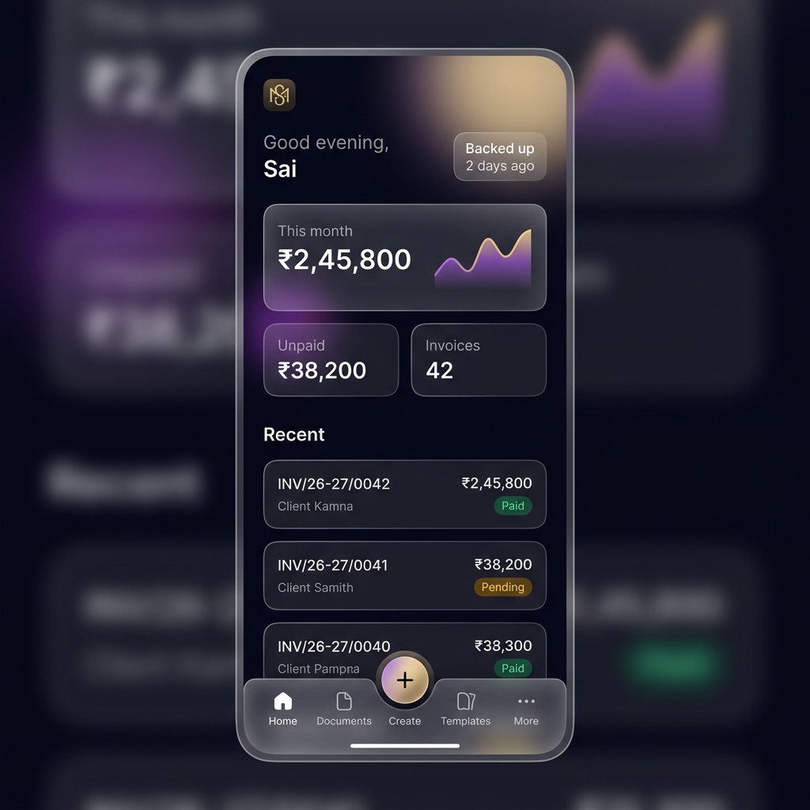

# INGEN — Design System ("Obsidian & Pearl")

> Single source of truth for brand identity, design tokens, themes, glassmorphism rules, typography, motion, and UI components. Built on **shadcn/ui** (Radix primitives) + **Tailwind CSS v4**.


---

## 1. Brand Identity & Logo

- **App Name:** INGEN
- **Tagline:** Local-First GST Invoicing & Document Studio
- **Logo Mark (`<IngenLogo />`):** Clean inline SVG monogram combining a folded ledger document with a subtle Indian Rupee (`₹`) stroke.
  - **Container:** Rounded square (`rx="22%"`), gradient fill from `#141126` to `#5B3FD9` with a 1px inner highlight (`rgba(232,194,122,0.35)`).
  - **Glyph:** Brushed Champagne Gold gradient (`#F5DFA0` → `#E8C27A` → `#B8892E`).
  - **Sizes:** `sm` (24px), `md` (32px), `lg` (48px), PWA icons (`192x192`, `512x512`, plus `512x512` maskable with 20% safe-zone padding).


---

## 2. Color Tokens (Dark "Obsidian" & Light "Pearl")

Both themes are first-class and switch via the `.dark` class on `<html>` (persisted in `settings.ui.theme` with `'dark' | 'light' | 'system'`).

### 2.1 Semantic CSS Variables (`src/design-system/tokens.css`)

| Token | Obsidian (Dark) | Pearl (Light) | Usage |
|---|---|---|---|
| `--background` | `#0B0B14` | `#F8F7FC` | App canvas background |
| `--foreground` | `#F5F5F7` | `#12111A` | Primary text |
| `--card` | `rgba(22, 21, 36, 0.72)` | `rgba(255, 255, 255, 0.82)` | Card / surface fill |
| `--card-foreground` | `#F5F5F7` | `#12111A` | Card text |
| `--popover` | `#151424` | `#FFFFFF` | Dropdowns, popovers, command |
| `--popover-foreground` | `#F5F5F7` | `#12111A` | Popover text |
| `--primary` | `#7C5CFF` | `#5B3FD9` | Primary brand actions (Amethyst) |
| `--primary-foreground` | `#FFFFFF` | `#FFFFFF` | Text on primary |
| `--secondary` | `#1C1A30` | `#EDE9FE` | Secondary buttons, chips |
| `--secondary-foreground` | `#E4E2F0` | `#2E1F6E` | Text on secondary |
| `--accent` / `--gold` | `#E8C27A` | `#9A7220` | Champagne Gold accents & badges |
| `--gold-surface` | `rgba(232, 194, 122, 0.14)` | `rgba(154, 114, 32, 0.12)` | Gold badge/highlight fill |
| `--muted` | `#171628` | `#F1EFF8` | Subtle backgrounds |
| `--muted-foreground` | `#9E9CB5` | `#64607A` | Secondary/helper text (WCAG AA ≥ 4.5:1) |
| `--border` | `rgba(255, 255, 255, 0.09)` | `rgba(18, 17, 26, 0.09)` | 1px hairlines |
| `--input` | `rgba(255, 255, 255, 0.12)` | `rgba(18, 17, 26, 0.14)` | Form control borders |
| `--ring` | `#E8C27A` | `#5B3FD9` | Keyboard focus ring |
| `--destructive` | `#F43F5E` | `#E11D48` | Danger / delete / overdue |
| `--success` | `#34D399` | `#059669` | Paid / finalized / verified |
| `--warning` | `#F5B544` | `#D97706` | Pending / partial / draft notice |
| `--aurora-1` | `rgba(124, 92, 255, 0.22)` | `rgba(91, 63, 217, 0.10)` | Top-right ambient glow |
| `--aurora-2` | `rgba(232, 194, 122, 0.14)` | `rgba(212, 168, 79, 0.10)` | Bottom-left ambient glow |

> [!IMPORTANT]
> **Contrast Rule:** Never use raw `#E8C27A` for text on a light background. Always use `text-gold` (`var(--gold)`), which automatically shifts to `#9A7220` in Pearl mode for WCAG AA compliance.

### 2.2 Tailwind v4 `@theme` Configuration

```css
@import "tailwindcss";

@theme inline {
  --color-background: var(--background);
  --color-foreground: var(--foreground);
  --color-card: var(--card);
  --color-card-foreground: var(--card-foreground);
  --color-popover: var(--popover);
  --color-popover-foreground: var(--popover-foreground);
  --color-primary: var(--primary);
  --color-primary-foreground: var(--primary-foreground);
  --color-secondary: var(--secondary);
  --color-secondary-foreground: var(--secondary-foreground);
  --color-muted: var(--muted);
  --color-muted-foreground: var(--muted-foreground);
  --color-accent: var(--accent);
  --color-gold: var(--gold);
  --color-gold-surface: var(--gold-surface);
  --color-border: var(--border);
  --color-input: var(--input);
  --color-ring: var(--ring);
  --color-destructive: var(--destructive);
  --color-success: var(--success);
  --color-warning: var(--warning);
  --font-sans: "Inter", system-ui, sans-serif;
  --font-display: "Plus Jakarta Sans", "Inter", system-ui, sans-serif;
  --font-mono: "Roboto Mono", monospace;
}
```

---

## 3. Glassmorphism & Performance Rules

To keep scrolling at 60fps on budget Android devices, `backdrop-filter: blur()` is restricted to **navigation chrome and overlays only**.

| Tier | Class / Component | Blur | Where Used |
|---|---|---|---|
| **Glass Chrome** | `.glass-chrome` | `backdrop-blur-xl` (20px) | `AppSidebar`, `BottomNav`, sticky `PageHeader`, `Dialog`, `Drawer` |
| **Glass Card** | `<GlassCard />` | None (solid translucent `--card` + 1px `--border` + top inner highlight) | KPI cards, panels, form sections |
| **List Row** | `.surface-row` | None (opaque/semi-opaque fill) | Virtualized document, client, and item rows |

- `@supports not (backdrop-filter: blur(1px))` falls back to 96% opaque `--popover`.
- Respects `@media (prefers-reduced-transparency: reduce)` and `settings.ui.reduce_motion`.

---

## 4. Typography & Numeric Discipline

- **Display (`--font-display`):** *Plus Jakarta Sans* (600, 700) for page titles, KPI numbers, and onboarding headers.
- **UI & Body (`--font-sans`):** *Inter* (400, 500, 600) for controls, tables, and inputs.
- **Monospace (`--font-mono`):** *Roboto Mono* for GSTIN, IFSC, invoice numbers, and formula editor.
- **Money & Quantities:** Always apply `tabular-nums` (`font-variant-numeric: tabular-nums`) so vertical columns of `₹` figures align to the pixel.

---

## 5. Layout & Navigation Architecture



- **Breakpoint:** `md` (`768px`).
- **Desktop (`≥ 768px`):** Fixed left `<AppSidebar />` (`248px` expanded, `68px` collapsed) + scrollable main region (`max-w-7xl mx-auto px-6 py-6`).
- **Mobile (`< 768px`):** Top compact header + scrollable content (`px-4 pt-3 pb-28`) + floating glass `<BottomNav />` with 5 slots:
  1. **Home** (`/`)
  2. **Documents** (`/documents`)
  3. **Create (`+`)** — raised circular amethyst-to-gold FAB opening the Quick Create sheet
  4. **Templates** (`/templates`)
  5. **More** — opens bottom Drawer with Clients & Items, Backup & Security, Companies, Settings

---

## 6. Component Inventory

### 6.1 shadcn/ui Primitives (`src/components/ui/`)
`button`, `input`, `textarea`, `label`, `select`, `combobox` (Popover + Command), `dialog`, `drawer`, `dropdown-menu`, `tabs`, `table`, `badge`, `switch`, `checkbox`, `tooltip`, `separator`, `skeleton`, `progress`, `scroll-area`, `sonner`.

### 6.2 INGEN Custom Design-System Components (`src/design-system/`)
| Component | Purpose |
|---|---|
| `<AuroraBackground />` | Fixed radial gradient backdrop behind the app shell |
| `<IngenLogo />` | Vector monogram + optional wordmark |
| `<GlassCard />` | Standard surface card with subtle top-edge sheen and hover elevation |
| `<StatCard />` | KPI metric card with label, `<MoneyText />`, delta badge, and mini sparkline |
| `<MoneyText />` | Formats `Decimal` strings in Indian grouping (`₹2,45,800.00`) with `tabular-nums` |
| `<StatusPill />` | Semantic badge for `draft`, `finalized`, `cancelled`, `paid`, `partial`, `unpaid` |
| `<ResponsiveDialog />` | Renders `<Dialog />` on `≥ md` and `<Drawer />` (bottom sheet) on `< md` |
| `<PageHeader />` | Title, subtitle, breadcrumbs, company chip, and primary action slot |
| `<EmptyState />` | Illustrated card with title, description, and primary CTA |
| `<BackupStatusChip />` | Shows "Backed up 2d ago" (emerald) or "Backup overdue" (amber) |
| `<CompanySwitcher />` | Dropdown/sheet to switch or add active `Company` |

---

## 7. Design System Showcase Route (`/dev/design`)

Built in **Phase 0** before any feature screens. Renders interactive samples of both themes, typography, color swatches, buttons, inputs, `<GlassCard />`, `<StatCard />`, `<StatusPill />`, `<MoneyText />`, and `<ResponsiveDialog />`.
