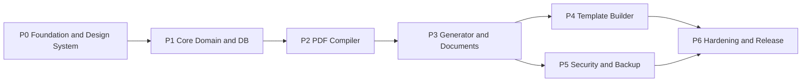

# INGEN — Roadmap

Phases are ordered so that **contracts come before UI**, and **risky parts are proven early**. Each phase ends in a state that can be demoed.

---

## P0 — Foundation & Design System
**Goal:** a themed, installable shell, with the riskiest platform assumptions verified.

- [ ] Vite + React 19 + TS strict, ESLint/Prettier, path aliases (`@/core`, `@/db`, …)
- [ ] Tailwind v4 + `shadcn init`; add the base components (see DESIGN_SYSTEM)
- [ ] Design tokens for Obsidian (dark) and Pearl (light); theme switcher
- [ ] Self-hosted fonts (Plus Jakarta Sans, Inter)
- [ ] INGEN SVG logo, favicon, PWA icons (maskable)
- [ ] Custom components: `AuroraBackground`, `GlassCard`, `StatCard`, `MoneyText`, `StatusPill`, `AppSidebar`, `BottomNav`, `CreateFab`, `ResponsiveDialog`, `PageHeader`, `EmptyState`
- [ ] AppShell with routing skeleton (empty pages)
- [ ] `/dev/design` showcase route
- [ ] vite-plugin-pwa (prompt update, manifest)
- [ ] **Spikes:**
  - react-pdf in a worker with Inter and ₹
  - pdf.js preview
  - iOS/Android two-step share
  - WebAuthn PRF availability check

**Exit:** the showcase looks right in both themes on a phone and on desktop; the app installs; all four spikes pass or have a documented fallback.

## P1 — Core Domain & DB
- [ ] `core/id`, `core/schema` (zod for every entity and the TemplateDefinition), `core/schema/migrations`
- [ ] `core/format`: money, number, date, percent, FY, amount in words
- [ ] `core/tokens`: token and pipe parser/resolver
- [ ] `core/formula`: parser, DAG, evaluator, rounding, GST presets, modifier-stack compiler
- [ ] `core/sequence`: patterns and periods
- [ ] `core/upi`: link builder and VPA validation
- [ ] `core/validate`: GSTIN checksum, PAN, pincode, state list
- [ ] `db/schema.ts` + repositories (with a crypto hook that does nothing until P5)
- [ ] Starter template JSONs (6) that pass zod validation

**Exit:** ≥ 95% coverage on `core/`; golden GST fixtures pass; starter templates validate.

## P2 — PDF Compiler
- [ ] Worker + Comlink API; font registry
- [ ] Shared `toPdfStyle`; page assembly (derived padding, fixed zones, body rows)
- [ ] Renderers for all 14 block types; page tokens; watermarks
- [ ] pdf.js preview component (lazy, virtualized pages)
- [ ] Visual regression harness for the starter templates

**Exit:** all starter templates render correctly at 1, 2, and 5 pages with sample data; visual baselines are committed.

## P3 — Generator & Documents
- [ ] Onboarding wizard + company management + company switcher
- [ ] Catalog (clients and items) + autocomplete
- [ ] Generator: dynamic form, line-item repeater, live totals, autosave, live preview
- [ ] Finalize flow (sequence, snapshots, PDF archive)
- [ ] Share/download/print; bulk export
- [ ] Documents list, detail view, payments, cancel, duplicate, convert
- [ ] Dashboard (KPIs, chart, recent documents, backup chip)

**Exit:** an E2E test passes offline: onboarding → invoice with 12 items → finalize → share or download → shown in the list with correct totals.

## P4 — Template Builder
- [ ] Builder store (Zustand + Immer + zundo); autosave; publish → version
- [ ] Desktop canvas: scale, zones, drag, resize, snap, smart guides
- [ ] Body grid editor (rows, columns, spans, sortable)
- [ ] Palette, layers, and an inspector for each block type; theme and page panels
- [ ] Field Registry editor and the Custom field quick-add
- [ ] Modifier Stack UI → formulas; validation panel
- [ ] Mobile skin: tap-select, bottom-sheet inspector, nudge, pinch zoom
- [ ] Preview PDF from the builder

**Exit:** the GST Classic template can be rebuilt from a blank template on desktop **and** on mobile, and its PDF matches the original.

## P5 — Security & Backup
- [ ] Vault: enable/disable, migration with progress (resumable), lock screen, auto-lock
- [ ] Biometric quick unlock (PRF) with password fallback
- [ ] Repository encryption layer + in-memory cache + search
- [ ] `.ingen` export (Everything / Templates / Data, Include PDFs, password)
- [ ] Import (preview diff, Merge or Replace)
- [ ] Backup reminders; asset GC

**Exit:** encrypted round-trip on a fresh browser profile restores everything byte-identical (PDF hashes match); a wrong password is rejected; a tampered file is detected.

## P6 — Hardening & Release
- [ ] Accessibility audit (axe), keyboard navigation, focus management
- [ ] Performance pass on a budget Android device; bundle-size budget checks in CI
- [ ] Playwright suites: offline, install, update prompt, vault, backup
- [ ] Error boundary + local diagnostics export (no telemetry)
- [ ] Hosting (static: Cloudflare Pages / Netlify / GitHub Pages) with strict CSP headers

**Exit:** Lighthouse PWA, performance, and accessibility scores ≥ 95; all E2E suites green.

---

## v2 Candidates
- Reports and GSTR-1 CSV export, sales by client or item
- Recurring invoices, payment reminders over WhatsApp text
- Indic-script PDF support
- Optional encrypted sync (user-owned storage such as Google Drive or WebDAV)
- File System Access auto-backup folder
- CSV import for clients and items
- Optional retention policies for non-tax documents
