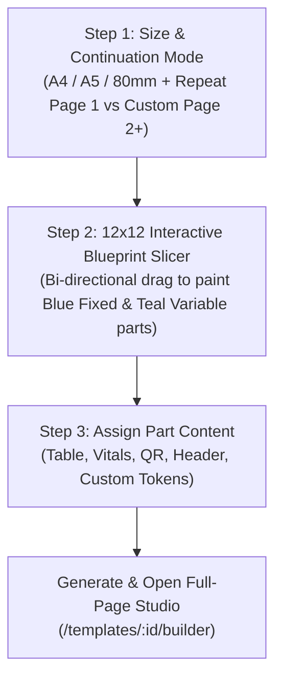

# 02 — Template Builder (Desktop & Mobile)

> Visual WYSIWYG template studio using a single canonical JSON model: absolute PDF-point frames in fixed zones (Header, Footer, Left/Right Sidebars) and a 12-column flow grid in the paginating Body, with full Multi-Page Continuation Templates and Interactive Blueprint Slicing.

## 1. Overview
Enables complete template customization on both desktop and mobile devices without coordinate drift or pagination bugs. Users can customize existing templates or design any template from scratch using a 3-step Page Architect, divide pages into custom fixed and variable sections, and configure dedicated Page 2+ continuation layouts.

## 2. User Stories
- **US-02.1:** As a user on desktop or mobile, I want to drag, resize, and style blocks in the header/footer/sidebars and reorder rows/columns in the body on a full-page interactive sheet.
- **US-02.2:** As a user, I want to **Create a Template from Scratch (`/templates/new`)** in 3 steps:
  1. **Page Size & Continuation Setup:** Choose a common page size (`A4 Portrait`, `A5 Compact Half-Page`, or `80mm Thermal Roll`), document category, and decide between **Repeating Page 1** or designing a **Custom Page 2+ Continuation Template**.
  2. **Interactive 12×12 Blueprint Slicer:** Click and drag in any direction across a 12×12 grid to paint and slice the page into parts (`6 Parts`, `9 Parts`, or custom freeform divisions) and color-code each part as a **Fixed Section (Blue)** or **Variable Section (Emerald/Teal)**.
  3. **Content Assignment:** Click each sliced part to assign its content (`Company Header`, `Logo & Title`, `Customer Bill-To`, `Invoice Meta / Patient Vitals`, `Expanding Line Items Table`, `UPI QR + Bank Details`, `Totals Box`, `HSN Summary`, `Terms/Notes`, `Signature`, `Custom Text with Tokens`, or `Empty Spacer`).
- **US-02.3:** As a user designing multi-page documents (e.g. multi-page invoices or medical prescriptions), I want a dedicated **Page 2+ Continuation Layout** where:
  - Page 1 contains full branding, tax headers, and business parameters.
  - Page 2+ contains a compact continuation header (e.g. Patient Name, Age & Vitals or Invoice Reference) and an expanded flexible table body.
  - If content overflows beyond Page 2 into Page 3 or Page 4, the Page 2+ continuation template automatically replicates across all subsequent pages.
- **US-02.4:** As a user, I want live height sliders (`28pt–340pt`) for both Header and Footer so that neither the header/footer nor the flexible body ever feels cramped.
- **US-02.5:** As a user, I want a fast, non-blocking **Preview PDF** modal that renders the live vector PDF without freezing the application, with 1-click "Open in Full Tab" and "Download PDF" options.

## 3. UX & Flows

### A. Scratch Page Architect (`/templates/new`)


1. **Step 1 — Format, Category & Continuation Strategy:**
   - Select Page Size: A4 (`595 × 842 pt`), A5 (`420 × 595 pt`), or 80mm Thermal (`226 × dynamic pt`).
   - Select Document Category: Tax Invoice, Bill of Supply, Quotation, Proforma, Receipt, Delivery Challan, or Clinic Prescription.
   - Choose Continuation Mode:
     - **Mode 1: Repeat Page 1 Layout:** All pages share the identical fixed header and footer; flexible body flows continuously.
     - **Mode 2: Custom Page 2+ Continuation Template:** Page 1 has full parameters, and Page 2+ has a streamlined continuation header that auto-replicates on Page 3+.
2. **Step 2 — Pure Full-Page Section Slicing:**
   - **Unified Page Partitioning:** Slices the full canvas cleanly into layout sections without requiring premature fixed/variable decisions.
   - **1-Click Full-Page Partition Presets:**
     - ⚡ **Standard 5-Zone (100% Page Coverage):** Full Header, Metadata Bar, Center Items Table, Financial Totals & Bank, and Signatory Footer.
     - 📑 **6-Part Layout:** Header, 2-column client & invoice info, full items table, 2-column totals & signature.
     - 💊 **Rx Prescription:** Clinic & Doctor Vitals, Patient Demographics, Rx Medication Table, Notes & Stamp.
     - ☰ **3 Full-Width Rows:** Top Brand Header, Flexible Body, and Bottom Payment Footer.
     - 🗂️ **4 Full-Width Rows:** Header, Meta Row, Items Body, and Financial Footer.
     - ⊞ **9-Part Grid (3×3 Matrix):** Equal 3×3 partitioned tiles.
     - ➕ **Fill Remaining Space:** Automatically computes unoccupied grid cells and creates sections covering 100% of the canvas.
     - 🗑️ **Clear Canvas:** Wipes sections to paint completely freehand.
   - **Section Splitting & Bounds Fine-Tuning:**
     - **Split Horizontally:** Bisects active section into stacked top and bottom sections.
     - **Split Vertically:** Bisects active section into side-by-side left and right columns.
     - **Coordinate Bounds Editor:** Exact Col 1–12 and Row 1–12 numerical inputs with live visual updates.
   - **Bi-Directional Drag Slicing:** Mathematical percentage-based pointer capture supporting drag in any direction (left, right, up, down, mouse or touch) with clean rectangular carving of overlapping zones.
3. **Step 3 — Section-Internal Freeform Item Placement, Fixed/Variable Text Fields, Photos & Advanced Tables:**
   - **Plain Sections by Default:** When creating custom templates, layout sections start cleanly with `items: []` and no pre-selected item (`activeItemId = ''`). Users decide what to place inside each section without unsolicited company name placeholders. Slicing sections on the grid consistently defaults to `mode: 'fixed'`, avoiding arbitrary row-based fixed vs variable toggling.
   - **Safe PDF Font Resolution:** All template font families (`Inter`, `Roboto`, `NotoSans`, `Helvetica`, `Courier`, `Times-Roman`) are gracefully mapped through `resolvePdfFontFamily` to standard PostScript fonts in `@react-pdf/renderer` without throwing runtime `Font family not registered` errors. Variable palette keys are deduplicated by token string (`${item.category}_${item.token}`) to eliminate duplicate React key console warnings.
   - **Locked Layout Sections & Section-Internal Freeform Canvas:**
     - Layout sections sliced in Step 2 (e.g., the recommended **6-Section Layout**) remain **locked in their grid coordinates** (`colStart..colEnd`, `rowStart..rowEnd`) in Step 3.
     - Clicking any layout section on the Full-Page Layout Overview selects that section (`activePart`) and opens its **Active Section Freeform Canvas** (`0..100%` width × `0..100%` height of that section).
     - Each layout section can be toggled between **🔵 Fixed Section** (repeats across pages) and **🟢 Variable Section** (dynamic flow).
   - **Adding, Dragging, Resizing & Deleting Multiple Items Inside a Section (`SectionItem[]`):**
     - Users can add multiple individual items (`+ Fixed Text Field`, `+ Variable Text Field`, `+ Image / Photo`, `+ Table`, `+ Totals`, `+ UPI QR`, `+ Signature`) **inside** the selected layout section.
     - Every item inside a section has independent percentage coordinates `(x%, y%, w%, h%)` within that section and can be freely dragged to reposition or resized from its bottom-right handle (`cursor-se-resize`) both in the **Active Section Freeform Canvas** and directly in-place on the **Full-Page Layout Overview**.
     - **Right-Click Context Menu & Keyboard Deletion:** Right-clicking any item inside a section opens a context menu (`Duplicate Item`, `Toggle Fixed / Variable Text`, `Delete Item`), and pressing `Delete` or `Backspace` deletes the selected item from the section.
   - **Fixed Text Fields vs. Variable Text Fields Inside a Section:**
     - **📌 Fixed Text Field (`textMode: 'fixed'`):** Static text or template expressions that stay constant in the template (e.g., Company Name, Address, Document Title, Section Headings, Terms).
     - **🔤 Variable Text Field (`textMode: 'variable'`):** Defines a custom or bound variable with:
       - **Variable Key (`variableKey`):** Unique identifier (e.g., `po_number`, `patient_age`, `vehicle_no`, `client_name`).
       - **Form Field Label (`variableLabel`):** Human-friendly label displayed in the Document Generator form.
       - **Optional Display Prefix (`variablePrefix`):** Prefix printed before the variable value on the invoice (e.g., `PO / Ref #: `).
       - **Default / Initial Value (`variableValue`):** Sample/default value displayed live on the canvas and pre-filled in the Document Generator when creating documents from this template.
   - **Custom Image / Photo Upload, Company Logo & Signature Normalization:**
     - **Image Normalization Pipeline (`compressAndNormalizeImage`):** Any user-selected image (photos, stamps, marks, logos) is pre-processed on an in-memory HTML5 canvas: resized to a maximum dimension of 1200px and converted to clean PNG/JPEG base64 Data URLs. This eliminates crashes and hangs caused by WebP, SVG, BMP, or 48MP mobile camera photos that `@react-pdf/renderer`'s native image decoders cannot parse.
     - **Image Inspector (`ImageBlockEditor`):** Available in both Step 3 Scratch Wizard and the Full Template Studio for both Fixed Zones and Body columns. Provides:
       - Image Source Selection: **Custom Upload / Photo** (`data_url`), **Company Logo** (`asset`), or **Authorised Signature** (`asset`).
       - Fit Mode: `contain` (maintains aspect ratio within bounds) or `cover` (fills container).
       - Alignment: `Left`, `Center`, or `Right`.
       - Live thumbnail preview, 1-click photo replacement button, and delete.
     - **Portable Definition Storage:** Custom images are embedded directly as base64 Data URLs in `block.source.data_url`, ensuring templates are completely self-contained when saved, cloned, or shared across devices without missing asset links.
     - **Live Canvas Feedback:** Step 3 and Studio canvas render true HTML `` elements mirroring the exact alignment, object-fit, and bounding frame of the final PDF.
   - **Dynamic Items Table Architecture & Visual Styles (`TableStylingBar`):**
     - **5 Line & Border Designs:**
       - 👻 `invisible`: **Invisible Lines (Zero Borders)** — Clean, modern, open whitespace layout without pagination border artifacts.
       - ━ `horizontal_only`: **Horizontal Ledger Lines** — Classic ledger dividing lines between rows and below headers only.
       - ⊞ `grid`: **Full Boxed Grid** — Matrix grid dividing all rows and columns with clean borders.
       - 🗂️ `card`: **Rounded Card Box** — Outer card boundary with rounded corners and row dividers.
       - ✦ `minimalist`: **Minimalist Underline** — Bold accent underline under the header and borderless item rows.
     - **Header & Visual Colors:**
       - Palette swatches (Brand Violet, Obsidian Charcoal, Teal Forest, Champagne Gold, Crimson Ruby, Midnight Navy, Slate Gray, Transparent Clean).
       - Native HTML5 color picker and Hex color input for both Header Background and Header Text.
       - Custom Border / Line Color picker and zebra striping toggle.
     - **Columns Reordering & 100% Auto-Balancing Width Sliders:**
       - **Drag & Drop Column Reordering:** Each column card features an HTML5 native draggable handle (`GripVertical`) and 1-click `ChevronUp` / `ChevronDown` swap buttons.
       - **100% Segmented Visual Proportion Bar:** Multi-colored preview bar reflecting each column's relative percentage with live total badge (`Total: 100% ✓`) and 1-click "Reset Equal Widths" button.
       - **Auto-Balancing Width Sliders:** Individual range sliders (`min: 5%`, `max: 80%`) for each column that proportionally redistribute remaining width so all enabled columns sum strictly to **100%**.
   - **Figma-Style Typography & Text Customization (`TextStylingBar`):**
     - Font family selection (`Inter`, `Helvetica`, `Times-Roman`, `Courier`), font sizes (`7–24 pt`), bold weight toggle, text alignment (`left`, `center`, `right`), color swatches + hex picker, and boxed card borders/backgrounds per individual text item.

### B. Full-Page Template Studio (`/templates/:id/builder`)
- **Interactive Sheet Canvas:** Shows the true-to-life page sheet (Header, Body Rows, and Footer) with 75%, 90%, and 100% zoom scaling.
- **Header & Footer Sliders:** Real-time range sliders adjust header height (32–340 pt) and footer height (28–260 pt).
- **Block Manipulation in Fixed Zones:** Pointer drag-to-move with 8pt grid snapping, plus corner drag-to-resize handles.
- **Variable Body Row & Column Grid:** Add rows, split into 1–12 column spans, adjust row and column gaps, and assign block types.
- **Page 1 vs Page 2+ Studio Switcher:** Quickly toggle between editing Page 1 and Page 2+ continuation zones.
- **Dual PDF Preview System:**
  - **4. Live PDF Preview Studio Tab:** A dedicated studio workspace pane rendering the compiled vector PDF inside a full-height interactive iframe, complete with Recompile, Open in Tab, and Download buttons.
  - **Vector PDF Preview Modal:** Click "Preview PDF (Modal)" from any tab to view the live PDF in a full-screen backdrop dialog.
  - **Iframe Blob Rendering:** Employs `<iframe src={`${blobUrl}#toolbar=1&navpanes=0`} />` with delayed object URL revocation (5000ms), avoiding Chromium's blob blocking behavior in `<object>` tags.

## 4. Technical Specifications
- **Continuation Page JSON Model:**
  ```ts
  interface TemplateLayout {
    zones: {
      header: FixedZone;
      footer: FixedZone;
      left: FixedZone;
      right: FixedZone;
    };
    body: {
      row_gap?: number;
      rows: BodyRow[];
    };
    continuation?: {
      mode: 'repeat_page_1' | 'custom_page_2';
      zones?: {
        header: FixedZone;
        footer: FixedZone;
      };
    };
  }
  ```
- **Blueprint Compiler (`compilePartsIntoTemplateDefinition`):**
  - Identifies top fixed sections and bottom fixed sections, computing safe `header.height` and `footer.height`.
  - For each fixed section, compiles every internal `SectionItem` (`x%, y%, w%, h%`) into an absolute `FixedBlock` frame:
    - `x = secX + (item.x / 100) * secW`
    - `y = secY + (item.y / 100) * secH`
    - `w = (item.w / 100) * secW`
    - `h = (item.h / 100) * secH`
  - For each variable section, groups sections by `rowStart` into `layout.body.rows` with proportional 12-column spans (`span = colEnd - colStart + 1`). Non-table items inside a variable section carry `rel_frame: { x, y, w, h, container_h }` so `@react-pdf/renderer` positions them accurately inside a relative `<View style={{ position: 'relative', height: container_h }}>` container while `table` blocks flow across pages naturally.
  - Automatically registers every Variable Text Field (`textMode: 'variable'`, `variableKey`, `variableLabel`, `variableValue`) into `TemplateDefinition.fields` with `default: item.variableValue` so the Document Generator renders form inputs pre-populated with their default values.
  - Supports on-the-fly "Preview Draft PDF" in Step 3 of the wizard before template generation.

## 5. Acceptance Criteria
- [x] 3-step Scratch Template Wizard allows picking A4, A5, and 80mm sizes with optional Page 2+ continuation.
- [x] Bi-directional drag painting on the 12×12 blueprint works in any direction without coordinate inversion.
- [x] Custom Page 2+ continuation layout replicates automatically on Page 3+ if content overflows.
- [x] Live height sliders prevent cramping in fixed header/footer and flexible body.
- [x] Preview PDF compiles asynchronously without freezing the UI, rendering cleanly in both a dedicated studio tab and responsive modal.
- [x] Chromium `<object>` blob blocking resolved by migrating to responsive `<iframe>` with toolbar flags and fallback action buttons.
- [x] Layout sections sliced in Step 2 (such as the 6-Section Layout) stay locked in their grid coordinates during Step 3.
- [x] Inside any selected layout section in Step 3, users can add, drag, reposition, resize, duplicate, right-click, and delete multiple individual items (`Fixed Text Field`, `Variable Text Field`, `Image / Photo`, `Table`, `Totals`, `UPI QR`, `Signature`).
- [x] Each Text Field item inside a section can be toggled between **Fixed Text Field** (static text / tokens) and **Variable Text Field** (with Variable Key, Field Label, Display Prefix, and Default Value that is entered later in the Document Generator).
- [x] Users can upload custom photos/logos from disk (`data_url`) or bind Company Logo / Signature and freely position & resize them inside a section.
- [x] Image uploads (WebP/SVG/BMP/large photos) are automatically normalized and resized via HTML5 canvas, preventing PDF compiler crashes.
- [x] Live HTML `` preview matches PDF alignment, object-fit, and dimensions in both Step 3 Scratch Wizard and Full Template Studio.
- [x] Table columns can be reordered via native drag-and-drop handles and 1-click up/down arrow buttons, and column widths sum strictly to 100% with auto-balancing sliders and a visual segmented proportion bar.
- [x] Step transitions validate template name (2-80 chars) and layout section existence with clear inline error feedback.
- [x] Variable text field keys are validated against slug format (`^[a-z][a-z0-9_]*$`, non-empty) with duplicate key collision detection across Page 1 and Page 2.
- [x] Multi-Page Continuation is an explicit opt-in checkbox (`[ ] Opt-in for Custom Page 2+`); templates default to clean single-page with no confusing continuation tabs unless opted-in.
- [x] Studio Header & Footer height sliders are non-intrusive and collapsed by default under "Adjust Zone Heights (Optional)", allowing 0 pt heights with 1-click "No Header" / "No Footer" options for stationery and receipt designs.
- [x] Canvas gracefully renders dashed helpers when Header or Footer is set to 0 pt, allowing 1-click re-enabling.
- [x] Mobile UI across Wizard toolbars, stepper indicators, section inspector, and Studio header use scrollable strips (`overflow-x-auto no-scrollbar`), responsive button text, and truncation to prevent overlapping and layout breaks.
- [x] Long descriptions, customer notes, and wide table data use the expandable `TruncatedTextWithReadMore` component.
- [x] Adjacent layout sections meet flush with 0 gap in both canvas and PDF output; blocking top title bars in Step 3 are replaced with floating overlay tags (`pointer-events-none`) and `inset-0` containers so users can position text and images up to the exact intersection boundary (`y = 0%` and `y = 100% - h%`) with edge snapping.

